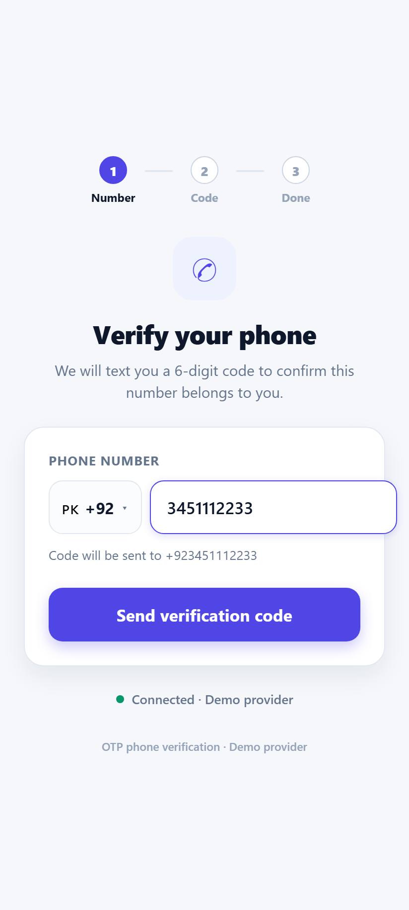
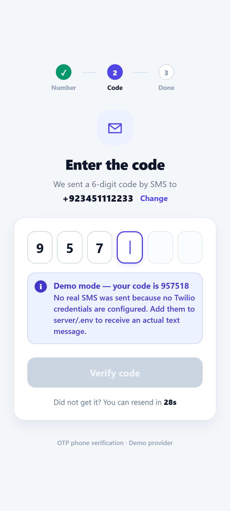
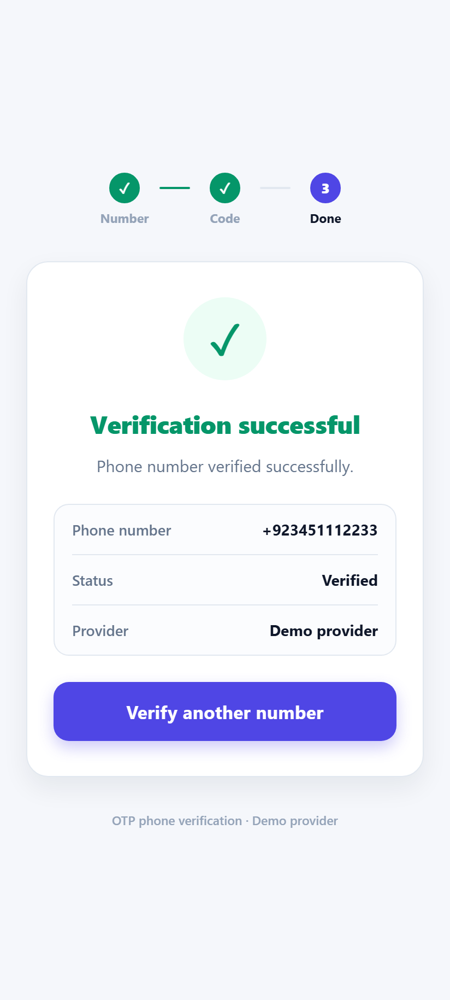
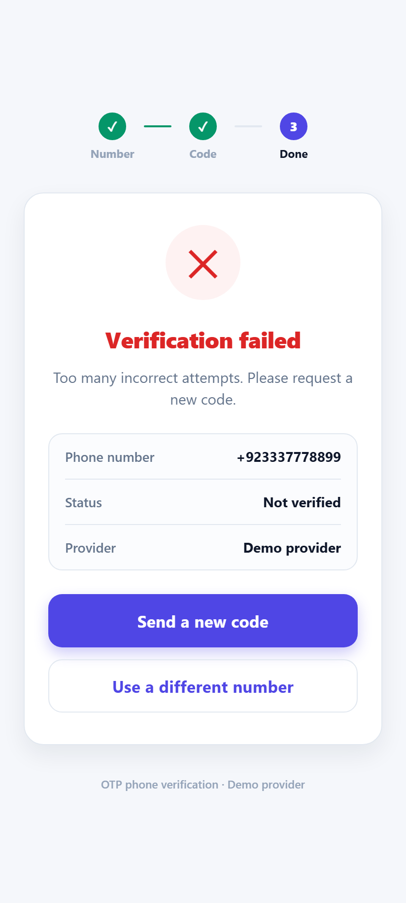

# OTP Phone Number Verification — React Native / Expo

A mobile app that verifies a user's **phone number** with a one-time passcode sent over **SMS**
(not email). Built with React Native + Expo, with a small Node/Express backend that talks to
**Twilio Verify**.

The app walks the user through three steps:

1. **Enter phone number** — country-code picker plus the local number, validated to E.164.
2. **Request and receive an OTP via SMS** — the backend asks Twilio Verify to text a 6-digit code.
3. **Enter the OTP and verify it** — the code is checked and the app shows an explicit
   **success or failure** message.

---

## Screenshots

| 1. Enter phone number | 2. Enter the OTP | 3. Success | 4. Failure |
| --- | --- | --- | --- |
|  |  |  |  |

A wrong code that is still retryable shows the remaining attempts inline:
[`05-wrong-code-inline.png`](docs/screenshots/05-wrong-code-inline.png).

**Screen recording:** [`docs/recording/otp-verification-demo.webm`](docs/recording/otp-verification-demo.webm)
— one full successful run followed by a failed one.

These were captured at a 412 x 915 phone viewport with the backend in demo mode, which is why the
code is visible on screen. See [`docs/README.md`](docs/README.md) for details and for how to
re-capture on a handset with a real SMS.

---

## Why there is a backend

Twilio credentials must never ship inside a mobile app — anything bundled into the app can be
extracted from the APK/IPA and used to send SMS on your account. So the flow is:

```
┌─────────────────┐   POST /api/otp/send     ┌──────────────────┐   Verify API    ┌────────────┐
│  Expo RN app    │ ───────────────────────► │  Express server  │ ──────────────► │   Twilio   │
│                 │   POST /api/otp/verify   │  (holds secrets) │                 │   Verify   │
│  phone + code   │ ◄─────────────────────── │                  │ ◄────────────── │            │
└─────────────────┘   success / failure      └──────────────────┘   approved?     └─────┬──────┘
                                                                                       │ SMS
                                                                                       ▼
                                                                                  📱 user's phone
```

The app never sees or stores the code. Twilio generates it, delivers it, and decides whether the
code the user typed is correct — the server only relays the answer.

---

## Demo mode: runs without a Twilio account

> **Why this project ships running in demo mode.** Twilio does not offer free trials in Pakistan —
> signing up lands on *"Trials are currently unavailable in your region"* with 0 free SMS and a
> prompt to add a payment method. Firebase Phone Auth is no longer an alternative either: SMS
> sign-in was removed from the free Spark plan in September 2024 and now requires the Blaze plan
> with billing attached. Pakistan also requires PTA-approved sender IDs for A2P messaging, which
> is why trial routes are blocked in the first place.
>
> The Twilio Verify integration in this repository is complete and real — see
> [`server/src/providers/twilio.js`](server/src/providers/twilio.js). It activates the moment
> credentials are present, with no code changes. What is missing is a funded SMS account, not the
> implementation.

The server ships with a **demo provider** that is used automatically when no Twilio credentials
are present:

- it generates a real random 6-digit code with a 5-minute expiry,
- prints it to the server console **and** shows it in the app in a clearly-labelled banner,
- enforces the same 5-attempt limit, single-use codes and 30-second resend cooldown.

Every screen, request and response is identical to the Twilio path, so the whole
send → receive → verify → success/failure flow can be demonstrated end to end on any machine.
Adding Twilio credentials to `server/.env` switches to **real SMS delivery** with no code changes.

---

## Tech stack

| Layer | Choice |
| --- | --- |
| Mobile app | React Native 0.88 via Expo SDK 58, TypeScript (strict) |
| State / nav | React hooks — a 3-step flow needs no navigation library |
| Backend | Node.js + Express 4 |
| OTP provider | Twilio Verify v2 (`twilio` SDK), with a built-in demo fallback |

---

## Getting started

### Prerequisites

- Node.js 18 or newer
- The **Expo Go** app on your phone, or an Android emulator / iOS simulator

### 1. Install

```bash
git clone <your-repo-url>
cd otp-phone-verification
npm install          # also installs the server's dependencies
```

### 2. Run the backend and the app

```bash
npm run dev          # starts the Express server and Expo together
```

Or in two terminals, if you prefer separate logs:

```bash
npm run server       # terminal 1 — http://localhost:4000
npm start            # terminal 2 — Expo dev server
```

Then scan the QR code with Expo Go, or press `a` for Android, `i` for iOS, `w` for web.

The first screen shows a **Connected** indicator and names the active provider, so you know
immediately whether the app can reach the backend.

### 3. Verify a number

1. Pick your country code, type your number without the leading zero, tap **Send verification code**.
2. In demo mode the code appears on screen and in the server console; with Twilio configured it
   arrives as a text message.
3. Type the 6 digits — the app verifies automatically on the last digit — and the result screen
   reports success or failure.

> **Phone on Wi-Fi:** the app works out your computer's LAN address from the Expo dev server, so
> Expo Go reaches the backend with no configuration. Both devices must be on the same network. If
> your network blocks that, run `npx expo start --tunnel` and set `EXPO_PUBLIC_API_URL` in `.env`
> to a public URL for the backend (e.g. an ngrok tunnel).

---

## Sending real SMS with Twilio

1. Create an account at [twilio.com/try-twilio](https://www.twilio.com/try-twilio).
2. Copy the **Account SID** and **Auth Token** from the Console dashboard.
3. Create a Verify service: **Console → Verify → Services → Create new**, then copy its
   **Service SID** (starts with `VA`).
4. Fill in `server/.env`:

   ```bash
   cp server/.env.example server/.env
   ```

   ```env
   TWILIO_ACCOUNT_SID=ACxxxxxxxxxxxxxxxxxxxxxxxxxxxxxxxx
   TWILIO_AUTH_TOKEN=your_auth_token
   TWILIO_VERIFY_SERVICE_SID=VAxxxxxxxxxxxxxxxxxxxxxxxxxxxxxxxx
   ```

5. Restart the server. It now prints `Provider : twilio` instead of `demo (DEMO MODE)`, the demo
   banner disappears from the app, and codes arrive by SMS.

On a **trial** account you must first add your own number under
*Phone Numbers → Verified Caller IDs*, otherwise Twilio rejects the send with error `21608`.

`server/.env` is git-ignored, so credentials stay on your machine.

---

## API

The server exposes three endpoints. All bodies are JSON.

### `GET /api/health`

```json
{ "ok": true, "provider": "twilio", "demoMode": false, "codeLength": 6 }
```

### `POST /api/otp/send`

```json
{ "phone": "+923001234567" }
```

Accepts spaces, dashes and brackets, and treats a leading `00` as `+`. Rejects anything that is
not valid E.164.

```json
{
  "success": true,
  "phone": "+923001234567",
  "provider": "twilio",
  "demoMode": false,
  "channel": "sms",
  "status": "pending",
  "codeLength": 6,
  "expiresInSeconds": 600,
  "resendAfterSeconds": 30
}
```

In demo mode the response also carries `"demoCode": "123456"`. Twilio never returns the code.

### `POST /api/otp/verify`

```json
{ "phone": "+923001234567", "code": "123456" }
```

```json
{
  "success": true,
  "verified": true,
  "status": "approved",
  "message": "Phone number verified successfully.",
  "phone": "+923001234567"
}
```

A wrong code is a normal outcome, not a transport error, so it returns **HTTP 200** with
`verified: false` and a message such as *"Incorrect code. 4 attempts remaining."* Expiry and
too-many-attempts come back as `status: "expired"` / `"max_attempts_reached"`.

Errors use `{ "success": false, "error": { "code", "message" } }` with a message that is safe to
show the user. Twilio's numeric error codes are mapped to plain English in
[`server/src/providers/twilio.js`](server/src/providers/twilio.js).

---

## Project structure

```
otp-phone-verification/
├── App.tsx                        # 3-step flow, stepper, backend health check
├── src/
│   ├── api/otp.ts                 # typed fetch client (timeouts, error mapping)
│   ├── components/
│   │   ├── OtpInput.tsx           # 6 digit boxes over one hidden input
│   │   ├── PrimaryButton.tsx      # button with loading/disabled states
│   │   └── Banner.tsx             # success / failure / info strips
│   ├── screens/
│   │   ├── PhoneScreen.tsx        # step 1 — number entry + country picker
│   │   ├── OtpScreen.tsx          # step 2 — code entry, resend countdown
│   │   └── ResultScreen.tsx       # step 3 — success or failure message
│   ├── config.ts                  # backend URL resolution, country list
│   └── theme.ts                   # colours, spacing, radii, shadows
├── server/
│   ├── src/index.js               # Express app and routes
│   ├── src/providers/
│   │   ├── twilio.js              # Twilio Verify v2 integration
│   │   ├── demo.js                # credential-free fallback provider
│   │   └── index.js               # picks the provider from the environment
│   ├── src/lib/phone.js           # E.164 normalisation, validation, masking
│   ├── src/lib/rateLimit.js       # resend cooldown + hourly send cap
│   └── .env.example
└── docs/                          # screenshots and screen recording
```

---

## Implementation notes

**OTP entry.** Six boxes are drawn on screen with a single transparent `TextInput` stretched over
them. One input (rather than six) means backspace, paste and the platform's SMS autofill all
behave correctly — `textContentType="oneTimeCode"` on iOS and `autoComplete="sms-otp"` on Android
let the OS offer the code straight from the incoming message. Verification fires automatically on
the sixth digit, with an in-flight guard so the auto-submit and the button cannot double-send.

**Backend URL discovery.** `localhost` on a physical phone means the phone itself, which is the
usual reason a student OTP demo fails on a real device. `src/config.ts` reads the LAN host Expo is
already serving the bundle from and reuses it for the API, falls back to `10.0.2.2` on Android
emulators, and lets `EXPO_PUBLIC_API_URL` override everything.

**Abuse protection.** 30-second resend cooldown and a cap of 5 sends per number per hour, enforced
server-side; codes are single-use and expire. The in-memory counters suit a single-instance demo —
a deployed service would keep them in Redis.

**Input handling.** Numbers are normalised before validation, so `0300 123 4567`, `00923001234567`
and `+92 300 1234567` all resolve to `+923001234567`.

---

## Troubleshooting

| Symptom | Fix |
| --- | --- |
| *Verification server offline* on the first screen | The backend is not running — `npm run server`. |
| Works on web, fails in Expo Go on a phone | Phone and computer must be on the same Wi-Fi; check your firewall allows port 4000, or use a tunnel plus `EXPO_PUBLIC_API_URL`. |
| Twilio error `21608` | Trial account — verify your number in the Twilio console first. |
| Twilio error `60200` | The number is not valid E.164; include the country code. |
| Server exits with a configuration error | `OTP_PROVIDER=twilio` is set but the credentials are incomplete. |

---

## Scripts

| Command | What it does |
| --- | --- |
| `npm run dev` | Backend + Expo together |
| `npm start` | Expo dev server only |
| `npm run server` | Express backend only |
| `npm run android` / `ios` / `web` | Open on a specific platform |
| `npm run typecheck` | `tsc --noEmit` |

---

## Course submission

Quiz 4 — Mobile Application Development (React Native / Expo): OTP phone number verification,
implemented with Twilio Verify. All source code is in this repository; screenshots and the screen
recording of the full send → receive → verify flow are in [`docs/`](docs/).
